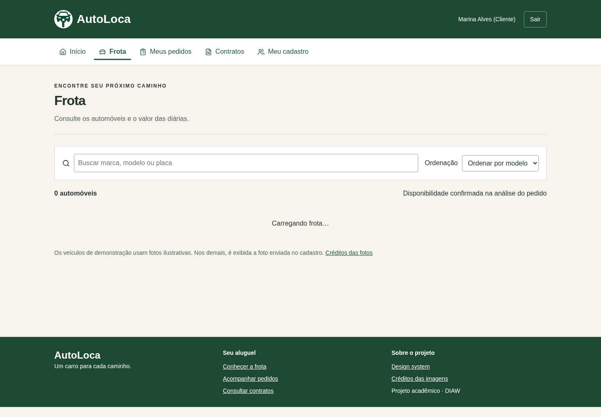
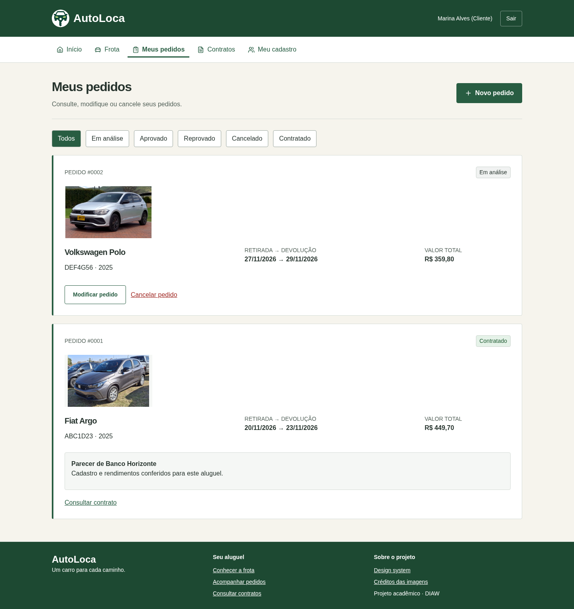

# AutoLoca

> Sistema web para cadastro de clientes, pedidos e contratos de aluguel de automóveis.


## 🚧 Status do Projeto

Protótipo acadêmico com execução local disponível. A hospedagem e a conexão com o Supabase da equipe ainda precisam ser verificadas.

## 📚 Índice

- [Links Úteis](#-links-úteis)
- [Sobre o Projeto](#-sobre-o-projeto)
- [Funcionalidades Principais](#-funcionalidades-principais)
- [Tecnologias Utilizadas](#-tecnologias-utilizadas)
- [Arquitetura](#-arquitetura)
- [Instalação e Execução](#-instalação-e-execução)
- [Estrutura de Pastas](#-estrutura-de-pastas)
- [Demonstração](#-demonstração)
- [Testes](#-testes)
- [Documentações utilizadas](#-documentações-utilizadas)
- [Autores](#-autores)

## 🔗 Links Úteis

- [Modelagem e histórias do usuário no Miro](https://miro.com/app/board/uXjVEQrwnNs=/)
- [Créditos das imagens](Front/public/carros/creditos.html)

## 📝 Sobre o Projeto

Projeto desenvolvido para o Laboratório 02 de Desenvolvimento e Integração de Aplicações Web, do professor João Paulo Aramuni. Clientes solicitam aluguéis pela Internet; empresas e bancos avaliam os pedidos e formalizam contratos após aprovação. O aluguel pode incluir crédito concedido por um banco.

## ✨ Funcionalidades Principais

- Cadastro e login de clientes, empresas e bancos.
- CRUD de clientes, com identificação, profissão e até três rendimentos.
- Cadastro de automóveis com foto, diária e proprietário.
- Criação, consulta, alteração e cancelamento de pedidos.
- Avaliação financeira e registro de parecer pelos agentes.
- Formalização de contratos e concessão opcional de crédito.

## 🛠 Tecnologias Utilizadas

| Parte | Tecnologias |
| --- | --- |
| Front-end | React, Vite, React Router, Tailwind CSS e Lucide |
| Back-end | Java 25, Spring Boot 4.0.2, Maven, Spring MVC, Spring Data JPA e Spring Security |
| Banco de dados | Supabase/PostgreSQL; H2 para demonstração local |
| Testes | JUnit Jupiter, Mockito e MockMvc |
| Infraestrutura | Docker para o backend e GitHub Actions para testes e build |

## 🏗 Arquitetura

A aplicação segue MVC com frontend React e API Spring Boot. Os controllers recebem as requisições, os services aplicam as regras de negócio e os repositories acessam o banco. Os DTOs representam os dados de entrada, e as entidades ficam no pacote `model`.

| Modelo | Imagens |
| --- | --- |
| Casos de uso | [Clientes](docs/modelagem/casos-clientes.png) · [Agentes](docs/modelagem/casos-agentes.png) |
| Classes | [Pedidos e contratos](docs/modelagem/classes-aluguel.png) · [Contas e propriedade](docs/modelagem/classes-contas.png) |
| Pacotes | [Visão lógica](docs/modelagem/pacotes.png) |
| Histórias do usuário | [HU01–HU08](docs/modelagem/historias-1.png) · [HU09–HU16](docs/modelagem/historias-2.png) |

## 🔧 Instalação e Execução

### Pré-requisitos

- JDK 25 e `JAVA_HOME` configurado.
- Node.js 22.12 ou superior e npm.
- Internet para baixar as dependências na primeira execução. O Maven é instalado pelo Wrapper.

### Variáveis de Ambiente

Para usar Supabase, copie `Back/.env.example` para `Back/.env` e preencha com os dados de **Connect → Session pooler**, porta 5432:

```properties
spring.profiles.active=supabase
DB_URL=jdbc:postgresql://SEU_HOST:5432/postgres?sslmode=require&currentSchema=autoloca
DB_USER=postgres.SEU_PROJECT_REF
DB_PASSWORD=SUA_SENHA
CORS_ORIGINS=http://localhost:5173
```

Não versione o `.env`. No frontend, `VITE_API_URL` pode ficar vazio para execução local: o proxy do Vite encaminha `/api` ao backend.

### Inicialização do Banco de Dados (PostgreSQL)

Execute [database/01-schema.sql](database/01-schema.sql) no SQL Editor de um banco vazio no Supabase. Para atualizar um banco da versão anterior sem fotos, execute [database/02-foto-automovel.sql](database/02-foto-automovel.sql).

As contas e os carros devem ser cadastrados pela interface. O backend valida o esquema do Supabase, sem criar as tabelas automaticamente.

### Como Executar a Aplicação

Na raiz do projeto, onde ficam `Back`, `Front` e `package.json`:

```bash
npm start
```

Esse comando funciona no Windows, inclusive no Git Bash. No Linux/macOS, use:

```bash
npm run start:unix
```

Os comandos instalam as dependências e iniciam frontend e backend. Acesse **http://localhost:5173**. A API utiliza a porta **8080**. Encerre com **Ctrl+C**.

Sem `Back/.env`, o perfil local utiliza H2 em arquivo, com seis carros e as contas abaixo. Esses dados não são criados no Supabase.

| Perfil | Usuário | Senha |
| --- | --- | --- |
| Cliente | `cliente` | `Cliente123!` |
| Empresa | `empresa` | `Empresa123!` |
| Banco | `banco` | `Banco123!` |

### Execução com Docker

Como alternativa, execute o backend em Docker. Dentro de `Back`:

```bash
docker build -t autoloca-back .
docker run --rm --name autoloca-back -p 8080:8080 -v autoloca-dados:/app/data autoloca-back
```

Para Supabase, substitua o comando `docker run` por:

```bash
docker run --rm --name autoloca-back -p 8080:8080 --env-file .env -e SPRING_PROFILES_ACTIVE=supabase autoloca-back
```

Nesse modo, execute somente o frontend em outro terminal, dentro de `Front`:

```bash
npm ci
npm run dev
```

## 📂 Estrutura de Pastas

```text
AutoLoca/
├── Back/            API Spring Boot e testes
├── Front/           Interface React
├── database/        Scripts SQL
├── docs/
│   ├── imgs/        Capturas da aplicação
│   └── modelagem/   Imagens dos modelos
├── package.json     Comandos de inicialização
└── README.md
```

## 🎥 Demonstração

| Frota | Pedidos |
| --- | --- |
|  |  |

## 🧪 Testes

Os testes do backend usam JUnit Jupiter, Mockito e MockMvc. Execute dentro de `Back`:

```bash
./mvnw test
```

No PowerShell, use `./mvnw.cmd test`. A suíte possui 43 testes em oito classes, com dependências simuladas, sem iniciar o banco.

Para conferir o frontend, execute dentro de `Front`:

```bash
npm ci
npm run lint
npm run build
```

## 🔗 Documentações utilizadas

- [Template de README do professor](https://github.com/joaopauloaramuni/desenvolvimento-e-integracao-de-aplicacoes-web/blob/main/TEMPLATES/template_README.md)
- [Projetos da disciplina](https://github.com/joaopauloaramuni/desenvolvimento-e-integracao-de-aplicacoes-web)
- [Spring Boot](https://docs.spring.io/spring-boot/)
- [React](https://react.dev/) e [Vite](https://vite.dev/)
- [Supabase](https://supabase.com/docs)
- [Tailwind CSS](https://tailwindcss.com/docs) e [Docker](https://docs.docker.com/)

## 👥 Autores

Samuel Ferreira Guimarães.
